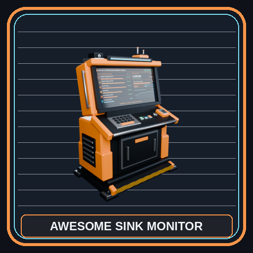

<p align="center">
  
</p>

# AWESOME Sink Monitor (`SinkMonitor`)

A **Satisfactory 1.0+** mod built on **SML (`^3.12.0`)** and **Unreal Engine `5.6.1-CSS`** (pure C++20 + automated Blender/UE5 assets, no `ContentLib` dependency) that adds the **AWESOME Sink Monitor Terminal** buildable.

Interact with the terminal anywhere in your factory to inspect live per-item `Items/min` (60-second rolling window), `Points/min`, session and lifetime sunk totals, active AWESOME Sink locations, and real-time progress toward your next FICSIT Coupon.

---

## Features

- **Custom Placeable Terminal (`SM_SinkMonitorTerminal`):** FICSIT-styled industrial diagnostic console with emissive telemetry display, hazard striping, 4 LODs, 3 convex collision hulls, Build Gun hologram, and custom 2D icons.
- **Live Per-Item Sink Telemetry:** Tracks exact `Items/min`, `Points/min`, session sunk count, and save-persisted lifetime sunk total across **every vanilla and modded sinkable solid item** (auto-discovered via `AFGResourceSinkSubsystem` + `UModContentRegistry`).
- **Coupon Status Strip:** Displays remaining points to next coupon, fill percentage bar, and live ETA at your current rate for both the **Standard Track** and **DNA Exploration Track**, alongside printable **Coupons Ready**.
- **Search, Filter, Sort & Pinning UI:**
  - Live instant search by item name
  - **Active Only** toggle and **All / Standard / DNA** track filters
  - 5 sort modes (`Rate/min`, `Points/min`, `Point Value`, `Lifetime Total`, `Name A–Z`), with **Pinned** items always surfaced first
  - Clickable item inspector displaying item icon, sink track, point value, rates, totals, and individual active AWESOME Sinks with coordinates
- **Multiplayer, Dedicated Servers & Save Safety:**
  - Server-authoritative telemetry using lock-free MPSC capture from Factory Tick worker threads (`AddPoints_ThreadSafe` + `Factory_CollectInput_Implementation`)
  - Compact server-to-client replication and `USinkMonitorRemoteCallObject` RPCs (`TogglePin`, `ResetSession`, `RequestSync`)
  - Packaged for `Windows` (Steam & EGS), `WindowsServer`, and `LinuxServer`
  - Uses soft class paths (`TSoftClassPtr`) in save records so uninstalling content mods never corrupts saves

---

## Unlock & Build Recipe

- **Unlock:** Automatically unlocked alongside HUB Tier 2 **Resource Sink Bonus Program** (`Schematic_2-2`), and silently retro-granted on existing or Creative saves that already have the AWESOME Sink unlocked.
- **Build Menu Location:** `Special -> AWESOME`
- **Build Cost:**
  - `4×` Reinforced Iron Plate
  - `8×` Cable
  - `4×` Copper Sheet
  - `2×` Quartz Crystal

---

## Build, Test & Packaging

### Standalone C++20 Unit Tests

```bash
mkdir -p build
g++ -std=c++20 -Wall -Wextra -Werror \
  -I SinkMonitor/Source/SinkMonitor/Public \
  SinkMonitor/Tests/test_rate_tracker.cpp \
  -o build/test_rate_tracker && ./build/test_rate_tracker
```

### Multi-Target Shipping Packaging (`Windows`, `WindowsServer`, `LinuxServer`)

Requires `UE_5.6.1-CSS`, `SML ^3.12.0` starter project (`SatisfactoryModLoader` with `Mods/SinkMonitor` symlinked), and `msvc-wine`:

```bash
./tools/package_release.sh
```

Outputs `SinkMonitor.zip`, `SinkMonitor-Windows.zip`, `SinkMonitor-WindowsServer.zip`, and `SinkMonitor-LinuxServer.zip` into `dist/`.

---

## Project Layout

```text
SatisfactorySinkMonitor/
├── AGENTS.md                                       # Workspace architecture & coding rules
├── LICENSE                                         # MIT License
├── README.md                                       # Overview, unlock/recipe & build guide
├── awesome_sink_monitor_antigravity_project_layout.md
├── assets/blender/                                 # Blender 5.3.0 generators, textures, FBX & icons
├── docs/                                           # Design spec, technical plan, renders & SMR listing
├── tools/
│   ├── package_release.sh                          # Unit test + multi-target RunUAT packaging script
│   └── ue_import_assets.py                         # Headless UnrealEditor-Cmd FBX & texture importer
└── SinkMonitor/
    ├── SinkMonitor.uplugin                         # SML ^3.12.0 plugin manifest (v0.1.0)
    ├── Config/                                     # AccessTransformers.ini, Alpakit.ini, PluginSettings.ini
    ├── Content/                                    # Cooked .uasset mesh, materials, textures & icons
    ├── Resources/                                  # Icon128.png
    ├── Source/SinkMonitor/                         # C++20 runtime, hooks, replication & Slate UI
    └── Tests/                                      # Pure C++20 rate tracker unit tests
```
