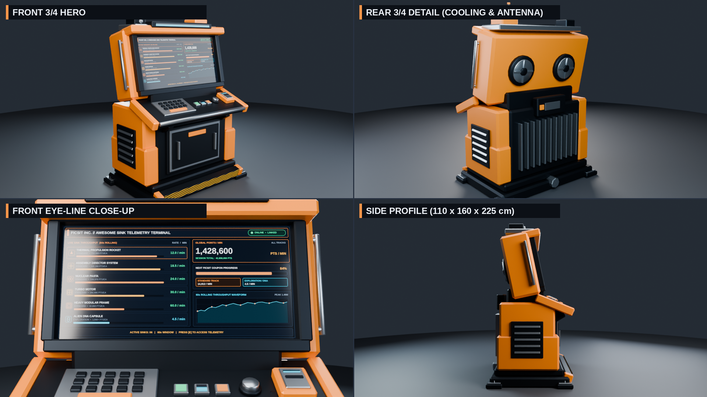

# ficsit.app (SMR) Submission Kit — AWESOME Sink Monitor (`v0.1.0`)

Use the fields below when creating or updating the mod listing on **https://ficsit.app/**.

---

## 1. Create Mod Form Fields

- **Name:** `AWESOME Sink Monitor`
- **Mod Reference:** `SinkMonitor`
- **Short Description** *(112 / 128 chars)*:
  ```text
  Adds a placeable telemetry terminal tracking live Items/min, Points/min, coupon progress, and active AWESOME Sinks.
  ```
- **Suggested Tags:** `Logistics`, `Quality of Life`, `UI`, `Multiplayer`, `Telemetry`
- **Mod Icon / Logo File:** [`docs/SMR_Logo.png`](file:///mnt/Workspace/Antigravity/SatisfactorySinkMonitor/docs/SMR_Logo.png)
- **Gallery Image / 3D Model Preview (Optional):** [`docs/renders/terminal_turnaround.png`](file:///mnt/Workspace/Antigravity/SatisfactorySinkMonitor/docs/renders/terminal_turnaround.png)
- **Source URL:** `https://github.com/drakkhis/SinkMonitor`

---

## 2. Full Description (Copy-Paste Markdown)

```markdown
**AWESOME Sink Monitor** adds a placeable **AWESOME Sink Monitor Terminal** to your factory so you can monitor everything your AWESOME Sinks are shredding in real time — without running between belts or guessing bottlenecks.



---

### Features

- **Real-Time Sink Telemetry (60s Rolling Window):** Tracks exact live **Items/min**, **Points/min**, **Session Total**, and save-persisted **Lifetime Total** for every item fed into any AWESOME Sink.
- **Coupon Progress Strip & Live ETAs:** Displays points remaining to your next FICSIT Coupon, fill progress bar, and live ETA (`~Nm SSs`) at your current point rate for both the **Standard Track** and **Alien DNA Exploration Track**, plus printable **Coupons Ready**.
- **Works With Vanilla & Modded Items:** Automatically discovers all sinkable solid items from the game's Resource Sink subsystem and modded item registry (`UModContentRegistry`), including items registered dynamically by other mods.
- **Searchable, Filterable & Sortable UI:**
  - Instant search box by item name
  - **Active Only** filter toggle
  - Track filter (**All Tracks** / **Standard** / **Exploration / DNA**)
  - Sort by **Rate/min**, **Points/min**, **Point Value**, **Lifetime Total**, or **Name (A–Z)**
  - **Pin / Favorite** important items to keep them sorted at the top
- **Per-Item Active Sink Breakdown:** Click any item to inspect its icon, sink track, point value, totals, and the individual active AWESOME Sinks currently consuming it (with world coordinates and per-sink rate).
- **Multiplayer & Dedicated Server Ready:** Authoritative server tracking with compact replication and RPC support (`Windows`, `WindowsServer`, and `LinuxServer`).
- **Save-Safe Design:** Uses pure C++ descriptors and `TSoftClassPtr` save records — no `ContentLib` dependency and safe alongside content mods.

---

### How to Unlock & Build

- **Unlock Requirement:** Automatically unlocks alongside HUB Tier 2 — **Resource Sink Bonus Program**.
- **Existing / Creative Saves:** Loading a save where Tier 2 Resource Sink (or the AWESOME Sink recipe) is already unlocked automatically grants the terminal schematic.
- **Build Menu:** `Special → AWESOME`
- **Build Cost:**
  - `4×` Reinforced Iron Plate
  - `8×` Cable
  - `4×` Copper Sheet
  - `2×` Quartz Crystal
```

---

## 3. Version Release Upload (`v0.1.0`)

- **Upload File:** [`dist/SinkMonitor.zip`](file:///mnt/Workspace/Antigravity/SatisfactorySinkMonitor/dist/SinkMonitor.zip) (`41 MB`)
- **Archive SHA-256:** `686663cce78e7a1beb963fa475b1a87626892a6c16f2766ec9b39f4421bff904`
- **Targets Included:** `Windows` (Steam & EGS), `WindowsServer`, `LinuxServer`
- **Version:** `0.1.0`
- **SML Dependency:** `^3.12.0` (`GameVersion >=517554`)
- **Stability:** `Alpha` (or `Beta` for initial `0.1.0` community testing)

### Release Notes / Changelog (Copy-Paste Markdown)

```markdown
### Initial Release (`v0.1.0`)

- Added **AWESOME Sink Monitor Terminal** buildable (`Special → AWESOME`, auto-unlocked at Tier 2 *Resource Sink Bonus Program* and retro-granted on existing unlocked saves).
- Added live 60-second rolling telemetry for `Items/min`, `Points/min`, session totals, lifetime saved totals, and active AWESOME Sink locations across all vanilla and modded sinkable solid items.
- Added **Coupon Status Strip** showing points remaining, progress bar fill, and live ETA to the next coupon for both **Standard** and **DNA** tracks, plus **Coupons Ready**.
- Added searchable, filterable, sortable, and pinnable terminal UI (`USinkMonitorInteractWidget`).
- Added server-to-client replication, multiplayer RPCs (`USinkMonitorRemoteCallObject`), and `Windows` + `WindowsServer` + `LinuxServer` support (`SML ^3.12.0`).
```
